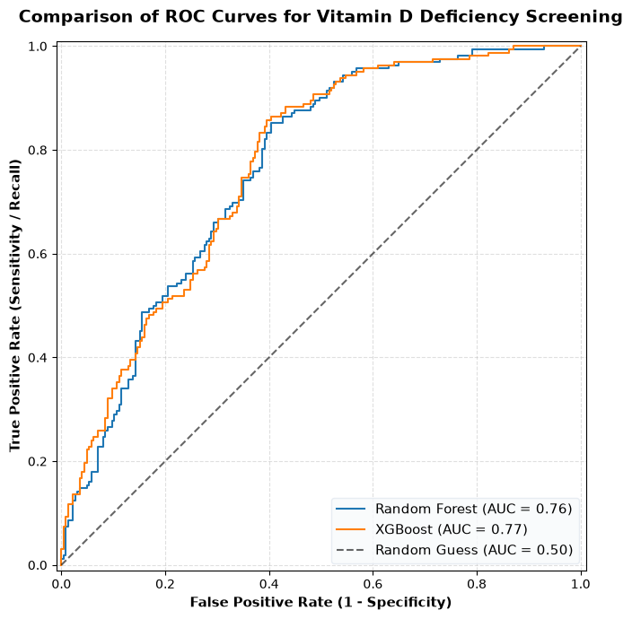
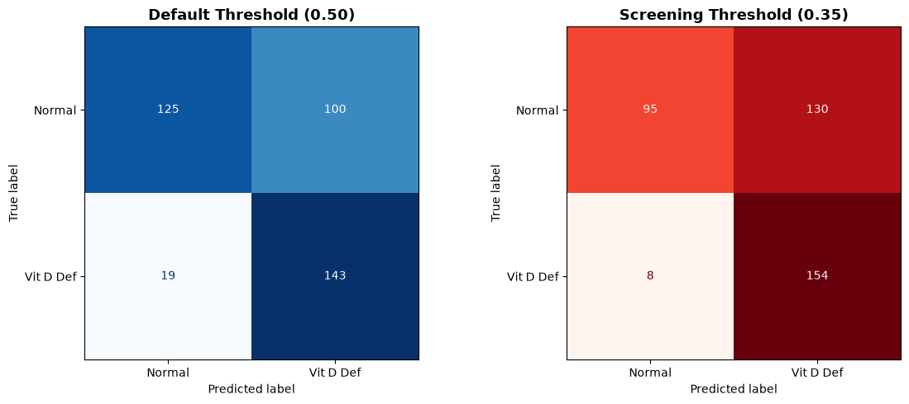
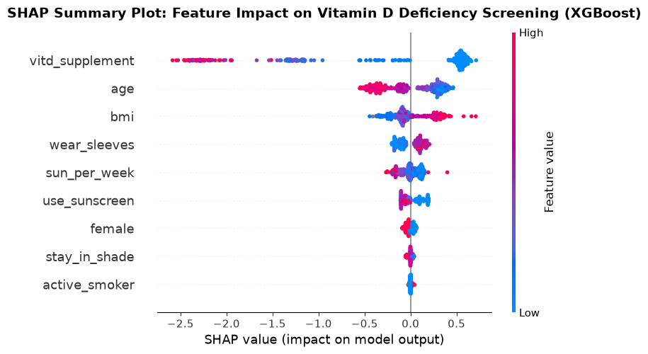
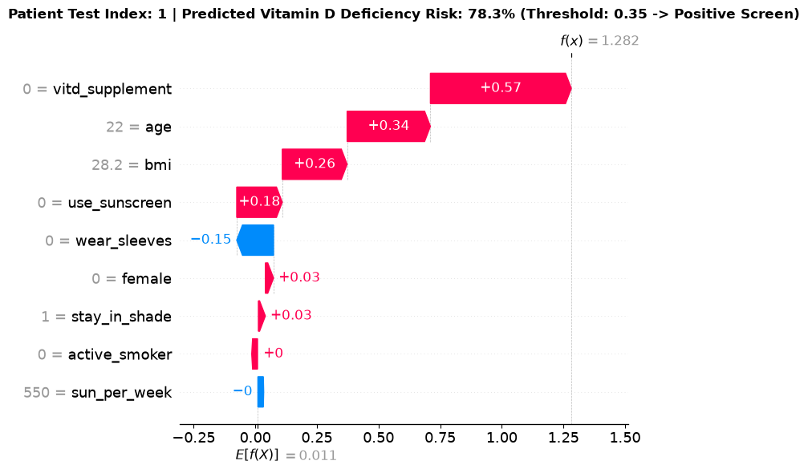

# Lifestyle-Based Vitamin D Deficiency Screening Model in Asian Adults

> **Note on Full Methodology:** The full step-by-step analytical workflow, code, and visualizations are documented in the [Primary Analysis Notebook](notebook/vit-d-screen.ipynb).

## 1. Clinical Background & Objective

This project investigates non-invasive screening for vitamin D deficiency in primary care settings with limited access to serum vitamin D level testing. It compares Random Forest and XGBoost using lifestyle, demographic, and anthropometric predictors to identify individuals for confirmatory evaluation. The notebook defines the binary endpoint as serum 25-hydroxyvitamin D **<50 nmol/L**.

An additional objective is to examine the relative contributions of lifestyle and demographic factors to predicted deficiency risk, providing interpretable evidence to inform targeted lifestyle counseling and preventive health promotion.

## 2. Cohort & Clinical Data Pipeline

The study integrates six NHANES modules across four survey cycles (2011–2018), joined by participant identifier (`SEQN`). The cohort comprises **1,935 Asian adults aged 20–59 years** with serum vitamin D measurements; confirmed pregnancies were excluded.

The model inputs comprise the following lifestyle, demographic, and anthropometric features:

| Feature | NHANES source | Description |
|---|---|---|
| Age (`age`) | `RIDAGEYR` | Age in years. |
| Sex (`female`) | `RIAGENDR` | Participant sex. |
| Body mass index (`bmi`) | `BMXBMI` | Body mass index (kg/m²). |
| Weekly outdoor exposure (`sun_per_week`) | `DED120`, `DED125` | Total time spent outdoors per week (minutes). |
| Shade-seeking (`stay_in_shade`) | `DEQ034A` | Frequency of staying in the shade. |
| Long-sleeve use (`wear_sleeves`) | `DEQ034C` | Frequency of wearing long sleeves outdoors. |
| Sunscreen use (`use_sunscreen`) | `DEQ034D` | Frequency of sunscreen use. |
| Vitamin D supplementation (`vitd_supplement`) | `DSQTVD`, supported by `DSD010` | Daily vitamin D intake from supplements (µg/day). |
| Recent smoking (`active_smoker`) | `SMQ680`, `SMQ681` | Smoking status during the past five days. |

*Feature definitions and transformations: [Exploring potential behavioral features](notebook/vit-d-screen.ipynb#exploring-potential-behavioral-features) and [Data structuring](notebook/vit-d-screen.ipynb#data-structuring).*

## 3. Methodology & Benchmark Performance

The cohort was divided into training and test sets using a stratified 80:20 split (`random_state=0`), yielding **387 test participants**, including **162 deficiency cases (41.9%)**. Class-weighted Random Forest and XGBoost models were tuned using five-fold grid-search cross-validation, selecting by ROC-AUC.

Test-set performance at threshold **0.50**, as reported in the notebook's model comparison table; best values are bolded.

| Metric | Random Forest | XGBoost |
|---|---:|---:|
| Accuracy | 0.6848 | **0.6925** |
| Precision | 0.5820 | **0.5885** |
| Recall (Sensitivity) | 0.8765 | **0.8827** |
| F1 score | 0.6995 | **0.7062** |
| ROC-AUC | 0.7627 | **0.7668** |



*Figure 1. Test-set ROC curves: Random Forest AUC 0.763; XGBoost AUC 0.767.*

The XGBoost threshold was lowered to **0.35** to better suit a screening test that prioritizes sensitivity. Test-set sensitivity increased from **88.27% to 95.06%**, reducing missed deficiency cases from **19 to 8**, while precision decreased from **58.85% to 54.23%**.



*Figure 2. Threshold 0.35 detects 154 versus 143 deficiency cases; false positives increase from 100 to 130.*

*Detailed evaluation: [Model Comparison and Calibration](notebook/vit-d-screen.ipynb#model-comparison-and-calibration) and [Clinical Threshold Optimization for Screening](notebook/vit-d-screen.ipynb#clinical-threshold-optimization-for-screening).*

## 4. Clinical Interpretability

### Model Interpretability and Clinical Explanation (SHAP)

SHAP identified **vitamin D supplementation** as the strongest lifestyle predictor, followed overall by **age and BMI**. Sex and other lifestyle factors—outdoor exposure, sun-protection behaviors, and smoking—contributed less to model predictions.



*Figure 3. Test-set SHAP summary: color denotes feature value; position indicates contribution to model output.*



*Figure 4. SHAP waterfall for test index 1: **78.3%** predicted deficiency probability; positive screen at threshold **0.35**.*

*Detailed analysis: [Model Interpretability and Clinical Explanation (SHAP)](notebook/vit-d-screen.ipynb#model-interpretability-and-clinical-explanation-shap).*

## 5. End-to-End Workflow & Reproducibility

The notebook's major checkpoints, in execution order, are:

1. [Import Packages and Load Dataset](notebook/vit-d-screen.ipynb#import-packages-and-load-dataset)
2. [Exploratory Data Analysis](notebook/vit-d-screen.ipynb#exploratory-data-analysis)
3. [Feature Engineering](notebook/vit-d-screen.ipynb#feature-engineering)
4. [Model Develoment and Evaluation](notebook/vit-d-screen.ipynb#model-develoment-and-evaluation)
5. [Model Comparison and Calibration](notebook/vit-d-screen.ipynb#model-comparison-and-calibration)
6. [Champion Model Selection: XGBoost](notebook/vit-d-screen.ipynb#champion-model-selection-xgboost)

The notebook records Python **3.14.6**. To install its imported packages and open it from the repository root:

```bash
python3 -m pip install pandas numpy matplotlib seaborn scikit-learn xgboost shap jupyterlab
cd notebook
python3 -m jupyterlab vit-d-screen.ipynb
```

Run cells sequentially with the notebook directory as the working directory. Data loading retrieves NHANES files from CDC and writes the merged CSV to `../data/nhanes_vitd_2011_2018.csv`.

---

The complete step-by-step analytical workflow, code, and visualizations are documented in the [companion notebook](notebook/vit-d-screen.ipynb).
